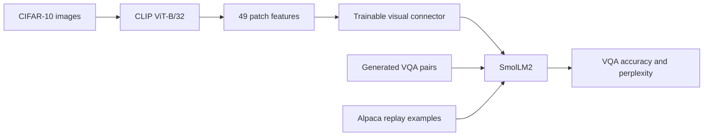

# CIFAR-10 Vision-Language Adapter

This Repo explores how a small language model can answer questions about images by connecting a pretrained vision encoder to its token-embedding space. It combines a learned visual connector, LoRA fine-tuning, and a language-model replay objective.

## What This Repo Does

The pipeline uses **CLIP ViT-B/32** (`openai/clip-vit-base-patch32`) to encode images and **SmolLM2-360M-Instruct** (`HuggingFaceTB/SmolLM2-360M-Instruct`) to generate answers. A trainable MLP maps CLIP's 768-dimensional patch features into SmolLM2's 960-dimensional embedding space.



The experiment has two training stages:

1. **Visual connector training:** Train the connector to condition SmolLM2 on image features and produce short, template-generated CIFAR-10 captions. CLIP's weights are frozen; the connector is the component optimized in this stage.
2. **VQA and language-model training:** Add LoRA adapters and train the adapter and connector on generated VQA examples, optionally mixing in Alpaca language-model loss: $L = L_{VQA} + \lambda L_{LM}$. The script runs four values of $\lambda$: `0.0`, `0.05`, `0.2`, and `0.5`.

## Data and Tasks

- CIFAR-10 is downloaded through `torchvision`. The script selects 2,000 stratified training images and 500 stratified validation images.
- Each image produces five rule-based question types: object recognition, binary identification, vehicle-or-living classification, flight ability, and animal classification.
- Connector training uses one of six short caption templates per training image.
- Alpaca is loaded from `tatsu-lab/alpaca`; the first 1,000 examples are used for replay during phase two.
- CLIP and SmolLM2 are downloaded from Hugging Face on first use.

## Setup

Create a virtual environment, install the dependencies, then run the training script:

```bash
python3 -m venv .venv
source .venv/bin/activate
python -m pip install --upgrade pip
python -m pip install torch torchvision
python -m pip install transformers datasets scikit-learn peft tqdm numpy
```

This Repo uses CUDA when available and otherwise runs on CPU.

## Run

From the Repo root:

```bash
python run.py
```

This downloads the datasets and pretrained models as needed, trains the connector, runs preliminary inference, calculates baseline perplexity, trains all four lambda settings, and evaluates the saved `lambda=0.2` adapter.

## Outputs

Generated files are written relative to the Repo root:

- `data/`: CIFAR-10 dataset files.
- `weights/connector_phaseA1.pt`: connector checkpoint after caption training.
- `weights/connector_phase2_lambda*.pt`: connector checkpoints for each lambda run.
- `weights/lora_phase2_lambda*/`: saved LoRA adapters.
- `weights/step_losses_lambda*.npz`: per-step VQA and language-model loss histories.

The final evaluation prints overall answer-token accuracy and breakdowns by question type and CIFAR-10 class. The lambda sweep prints VQA accuracy and perplexity summaries.

## Repo Structure

- `run.py`: end-to-end experiment entry point.
- `download_dataset.py`: CIFAR-10 splits, generated captions and VQA pairs, and Alpaca loading.
- `connector.py`, `connector_training.py`: visual projection module and caption-training loop.
- `smol_lm_training.py`: LoRA training, lambda sweep, perplexity, and VQA evaluation.
- `evaluation_vlm.py`, `vqa_inference.py`: detailed evaluation and qualitative inference.
